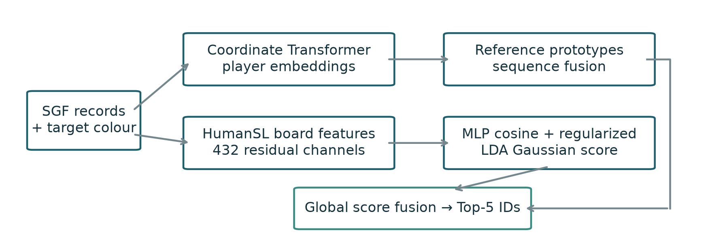
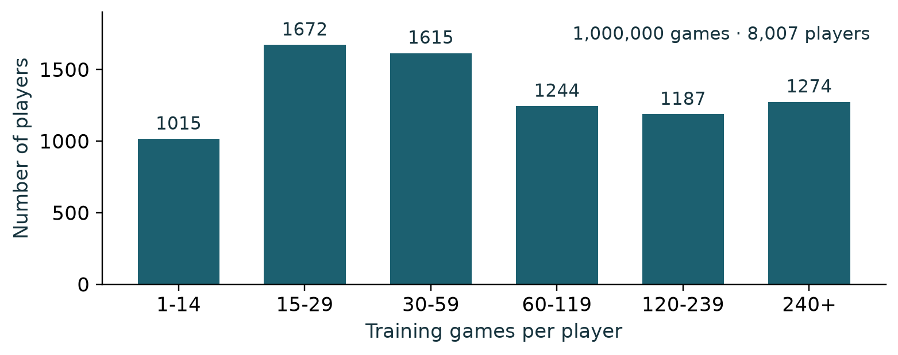
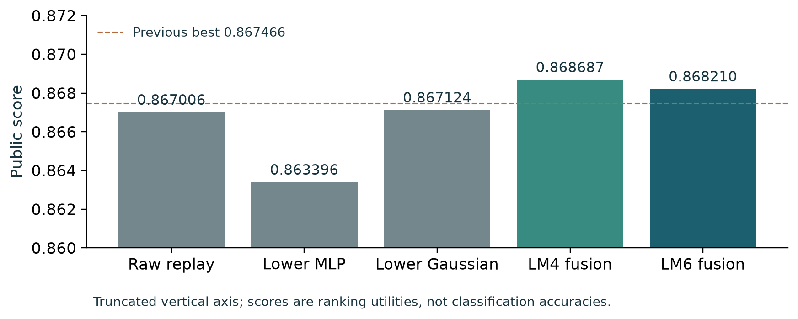

# Go Player Identification

**STAT5011 Statistical Deep Learning — Final Project**

**James Christian · R13921031**

Identify a Go player from a small collection of game records by ranking candidate reference players. This project combines move-sequence Transformer embeddings with frozen KataGo HumanSL decision features, a learned identity metric and variance-aware matching.

## Deliverables

- [Presentation — 22 editable slides](slides/STAT5011_Final_Presentation.pptx)
- [Final report — PDF](report/STAT5011_Final_Report.pdf)
- [Final report — editable Word](report/STAT5011_Final_Report.docx)
- [Report authoring text](report/STAT5011_Final_Report.md)

The report has **7 pages of main text**, followed by **1 reference page, 1 appendix page and 1 member-contribution page**. The separate final contribution page names James Christian and discloses AI assistance. The slides and report cover motivation, problem definition, data, literature, model comparison, methods, experimental results and conclusions.

## Results snapshot

| Item | Recorded result |
|---|---:|
| Highest achieved public score | **0.8686865** |
| Team | TEAM_10990 |
| Team rank at snapshot | **20 / 125** |
| Snapshot | November 22, 2026 JST |
| Leader score | 0.9313515 |
| Best prediction | `g22_cx40.csv` |

The headline is the highest achieved public score. Competition results are interim; the final private ranking is not yet available. This repository contains the course-project snapshot, not a medal claim.

## Visual overview







## Data and methods

The official processed training collection contains **1,000,000 games and 8,007 players**. The updated evaluation contains original pools of 400 players with 100 reference games each and new pools of 600 players with ten reference games each. New-family queries contain 1, 2, 3 or 5 games. The submission has 1,600 rows, split across public/private files and both test families.

The accepted score is `z(coordinate fusion with LM4) + 0.25*z(policy MLP cosine) + 0.10*z(regularized LDA Gaussian matching)`. Coordinate encoders use angular-margin identity training. HumanSL supplies 384 contextual and 48 policy-head residual channels per sampled move. The project evaluates repeated-player retrieval; it does not impose a one-to-one answer assignment.

The scaling study fits a metric on **90,000 games from 6,000 training players**, disjoint from the fixed holdout identities. The mean audit proxy score increased from 0.7104 to 0.7191. This study's candidate had not received public feedback at the reporting cutoff.

## Reproduce

- [Official data placement and model inference](docs/REPRODUCTION.md)
- [Build the report, presentation and figures](docs/BUILD.md)
- [Sources, attribution and limitations](docs/ATTRIBUTION.md)
- [Machine-readable evidence](results/)

Saved-model inference from frozen intermediate coordinate scores and extracted HumanSL features is verified against the exact scored prediction hash. A legacy base-view raw-input reconstruction discrepancy is retained explicitly in the report and reproduction guide. Raw game records, account credentials and large model checkpoints are not committed here. Frozen model assets remain in the authorized private competition repository.

## Repository map

```text
slides/        editable presentation and structured slide snapshot
report/        7-page main report, excluded sections, and authoring source
figures/       measured charts and schematic diagrams, PNG and editable SVG
results/       aggregate data summary, sanitized scores, validation evidence
model_src/     frozen model and inference source with a hash manifest
scripts/       document, chart and presentation builders
 docs/         reproduction, build, attribution and sources
```

All course-specific material is private while the competition is active. Share access only with the intended authorized course audience. The official data and external model licenses retain their own terms. Generative-AI assistance is disclosed on the report's separate contribution page.
