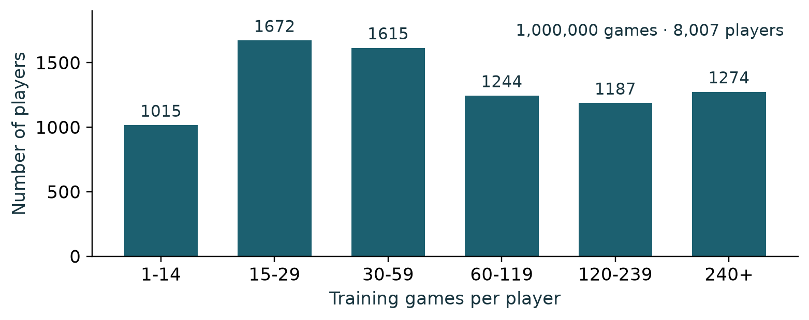
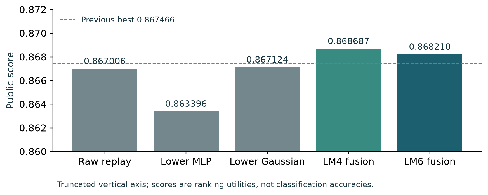
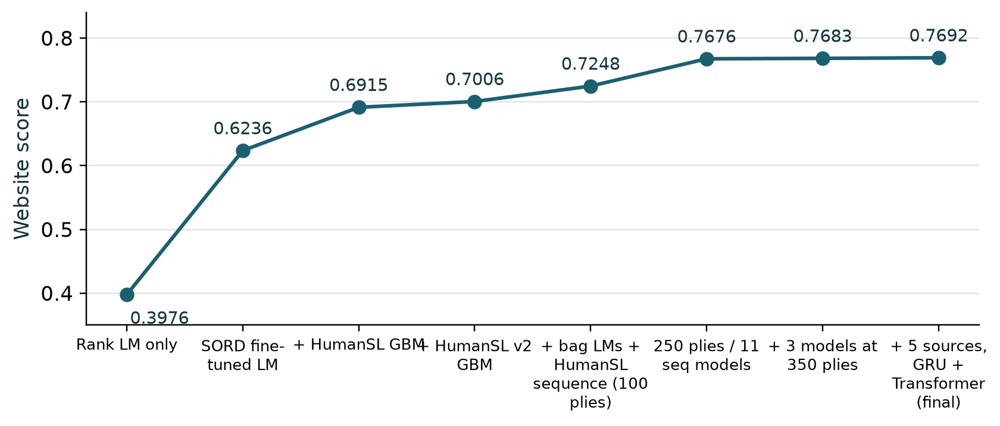

# Identifying Go Players and Predicting Their Rank from Game Records

STAT5011 Statistical Deep Learning | James Christian | R13921031

## Abstract

This project studies player identification from Go game records as a retrieval problem. A query contains a small set of games, and the system ranks anonymous candidate players represented by reference games. The approach combines coordinate-sequence Transformers trained with angular-margin identity supervision with features from KataGo HumanSL, a pretrained model of human moves. A learned policy metric and a regularized Gaussian reference model supplement the sequence ensemble. The highest achieved public score is 0.8721950. The team ranked 20 of 131 at the November 24 best-restoration upload. A second task, predicting the ordinal rank of a player (D to 6D) from a bag of games, uses the same frozen HumanSL network in bag-pooled sequence models and scored 0.7692 (rank 19 of 175). The submission period has ended; the dated public standings are not final private rankings.

## 1 Research motivation and problem

A game record contains decisions rather than an explicit biometric identifier. Move sequences may reflect opening preferences, local responses, risk tolerance, or playing strength. Identifying a player from such behavior is a form of behavioral stylometry. It is useful for studying how representation learning separates stable individual tendencies from properties shared by many players. It also raises privacy questions because an apparently anonymous sequence may reveal a persistent identity [1, 2].

The input consists of SGF records, target-player colour, and a candidate reference collection. For query Q and candidate player c, the objective is to learn a score S(Q,c) and return five distinct IDs in descending order. In the harder test family, Q contains only one, two, three, or five games, while each of 600 candidates has ten reference games. The target identity may occur in multiple queries; a one-to-one assignment constraint is therefore inappropriate.


The research questions are whether move-sequence embeddings generalize across players, whether board-conditioned decision features add information beyond coordinates, and whether reference-game variability should influence matching. The project is evaluated with the official exponentially discounted top-five score, rather than ordinary classification accuracy. An exact top-one identification contributes one; positions two through five contribute progressively less [1].

# 2 Data and evaluation setting

The official processed training collection contains 1,000,000 games from 8,007 player IDs. The aggregate counts were computed directly from the project training arrays. SGF records supply move order and board coordinates; the processing also records target-player colour and handicap. The training distribution is uneven: 1,015 players have fewer than 15 games, whereas 1,274 have at least 240. This matters for identity classification and for choosing players with enough games to construct retrieval episodes.



Test family per public or private pool | Original | New
--- | --- | ---
Candidate players | 400 | 600
Reference games per player | 100 | 10
Query game counts | 5, 10, 15, 20 | 1, 2, 3, 5
Questions per pool | 400 | 400

Each family has separate public and private files. There are 1,600 submitted prediction rows in total: 800 public questions and 800 private questions. Within each family and split, each of the four query sizes occurs 100 times. Candidate players can repeat across questions. The original pools contain 40,000 reference games each; the new pools contain 6,000 each. The November 11 test update reset the leaderboard, so the experiment uses the updated test files rather than combining scores across incompatible versions [1].

For a query whose correct player appears at rank r, the utility is exp(-(r-1)) if r is at most five and zero otherwise. Thus the five nonzero rewards are approximately 1.0000, 0.3679, 0.1353, 0.0498, and 0.0183. The reported public number averages this ranking utility on the public evaluation subset. It should not be described as a percentage of queries classified correctly.

Raw game records and restricted competition files are not redistributed in the course repository. The repository contains aggregate statistics, source code, result evidence, and instructions for placing an authorized copy of the official data. The official v1.1 archive checksum and frozen model references support version control of the inputs.

# 3 Literature review and model comparison

Transformers model interactions between positions through self-attention rather than a fixed local receptive field. Their original formulation established a general sequence-modeling architecture [3]. Here, the relevant sequence is the ordered list of Go moves. Coordinates alone do not explicitly encode captures or tactical board structure, but language-model pretraining can learn regularities in move transitions. This motivates a second, board-conditioned representation rather than assuming that a larger sequence model solves all aspects of the task.

McIlroy-Young et al. studied behavioral stylometry in chess using Transformers and few-shot player identification [2]. Their setting supports the idea that decision sequences contain individual signatures. Their reported accuracy is not directly comparable with this competition: the game, candidate set, number of reference games, and metric differ. This report uses the paper to motivate retrieval representations, not to claim that its numerical results transfer to Go.

ArcFace adds an angular margin to normalized classifier logits [4]. Although proposed for face recognition, the objective can encourage identity embeddings with compact within-player structure. The project applies this loss to game embeddings and discards the training-player classifier at retrieval time. The inference target is similarity to supplied reference games, not prediction of one of the training labels.

KataGo HumanSL predicts human moves conditioned on player profiles [5]. The frozen humanv0 network is therefore a task-related source of board-state features, but it is not an identity-recognition backbone. The model can reflect rank, server, and game-context effects as well as style. Local scaling, such as CSLS in embedding retrieval [6], also motivates attention to crowded neighborhoods; it does not establish that an unmodified language-translation retrieval rule is optimal for Go.

Approach | Representation and role | Limitation
--- | --- | ---
Official tutorial [7] | Board-history ResNet and retrieval baseline | Different baseline protocol
Sequence branch | Move LM → identity embedding | Board state is implicit
HumanSL branch [5] | Frozen contextual decision features | Not trained for player identity
Metric and fusion | MLP, LDA and Gaussian matching | Selection can overfit validation

The resulting contribution is an empirical combination of task-specific sequence learning and pretrained decision features, with negative results and reproduction checks retained. The evidence does not establish a new state-of-the-art architecture. The leading teams’ private methods are unknown, and the observed leaderboard gap cannot identify which backbone they use.

# 4 Deep representations and policy features

The coordinate language model embeds board location, move colour, positional index, and handicap context, then applies Transformer layers. The LM4 configuration uses hidden width 1,024, 16 layers, 16 attention heads, and a maximum of 320 plies. Identity fine-tuning pools hidden states from the target player’s moves and projects them to a normalized 256-dimensional embedding. For the accepted LM4-derived member, the run used seed zero, four epochs, learning rate 0.0001, ArcFace scale 20 and margin 0.1, and no orientation augmentation. Epoch two was selected in advance for this all-player run.

For normalized embedding e and class direction W_y, the target logit is s cos(theta_y + m), while competing logits are s cos(theta_j). Cross-entropy then trains the identity representation. At retrieval time, normalized game embeddings are averaged within each reference or query set and compared by cosine similarity. The production coordinate score also inherits earlier multi-model, auxiliary-view and rank-gating fusion; it is not the output of a single Transformer.


The HumanSL branch reconstructs board states and samples up to 48 own moves between plies 8 and 199. It uses the frozen b18c384nbt-humanv0 model with a fixed 3-dan profile. At each sampled decision, h(a) concatenates the 384-channel contextual trunk feature and the 48-channel policy-head feature at board point a. The residual is the feature at the actual move minus its policy-weighted expectation:

```text
r = h(a_played) - sum_a pi(a | board, profile) h(a)
```

The expectation is conditioned on the 361 non-pass board points. A game is summarized by the mean of these 432 residual channels. The policy-head component has a gradient interpretation for a conditional move model; the trunk component is treated only as a contextual residual feature. Games with unsupported handicap setup or failed replay are rejected as whole games, rather than retaining a corrupted prefix. The audited new-family test extraction processed all 14,200 games successfully.

A small network maps standardized residual means through LayerNorm, a 512-unit GELU layer with dropout 0.15, and a 256-dimensional output. ArcFace training uses 1,000 players outside the fixed holdout. AdamW uses learning rate 0.001 and weight decay 0.05. The preserved checkpoint is epoch five; longer training worsened local retrieval. Reference and query game embeddings are pooled before cosine scoring.

# 5 Regularized matching and experimental protocol

A player’s ten reference games need not form a single tightly concentrated point. To represent within-player variation, the policy residual is standardized using training statistics and projected using regularized linear discriminant analysis. The accepted projection is fitted on 90,000 games from 6,000 training identities; it uses 128 dimensions and a within-class covariance shrunk halfway toward a scaled identity matrix. This fixed shrinkage is a modeling choice, not an estimated optimal shrinkage coefficient.

In the projected space, each player has a reference mean mu_c and a diagonal game variance v_c. The scoring variance is 0.8 times the pooled reference variance plus 0.2 times the player-specific variance, with a small numerical floor. For a query mean qbar based on k games, the Gaussian score uses a quadratic distance scaled by 1/k + 1/10 and a log-variance penalty. This approximates uncertainty in two finite game-set means; dependence between games can invalidate a literal probabilistic interpretation.

```text
G(q,c) = -0.5 sum_j [(qbar_j - mu_cj)^2 / {v_cj (1/k + 1/10)} + log(v_cj)]
```

Scores are standardized within each query over candidate players. The accepted combination is:

```text
S = z(S_coordinate with LM4) + 0.25 z(S_policy MLP) + 0.10 z(G_expanded)
```


A fixed seed excludes 800 player IDs from metric training. The policy pilot samples 600 of those players with 15 games each. Five fixed permutations create ten reference games and five disjoint potential query games; query sizes one, two, three and five are evaluated. Hyperparameters are selected on 300 query-player rows, while the other 300 rows form a separate audit within the same 600-candidate retrieval pool. Reference and query game indices are disjoint in each episode.

The audit identities had already appeared in earlier experiments, and the six-encoder local baseline is a proxy for the larger production ensemble. Consequently, the audit is useful for controlled local comparisons but is not an untouched estimate of generalization. Public feedback also influenced global fusion weights across many submissions. A final private evaluation is necessary to assess the effect of this adaptive selection.

# 6 Competition experiments and results

The highest achieved public score is 0.8721950, from g23_greplace.csv. The exact same prediction bytes were restored as best_872195.csv on November 24. TEAM_10990 ranked 20 of 131 at that upload. The last observed leader score was 0.9313515, a gap of 0.0591565. The submission period has ended; the dated public rank is not a verified final private ranking.



Configuration | Public score | Change from LM4 best
--- | --- | ---
LM4 + MLP + older Gaussian | 0.8686865 | Baseline
Expanded cosine, weight 0.25 | 0.8672784 | -0.0014081
Expanded Gaussian, weight 0.10 | 0.8721950 | +0.0035085
Individual-game Gaussian likelihood | 0.8720487 | +0.0033622
Full-covariance Gaussian | 0.8712192 | +0.0025327
Expanded Gaussian, weight 0.15 | 0.8702170 | +0.0015305

Replacing the older 1,000-player Gaussian with the 6,000-player projection at weight 0.10 improved the best by 0.0035085. The coordinate fusion and learned-policy weight stayed fixed. Adding expanded cosine features instead reduced the website score, despite a larger local gain. Thus scaling helped through the chosen reference-distribution model, not through every use of the expanded projection.

The three November 24 variants all scored below the accepted 0.8721950. Increasing the Gaussian weight to 0.15 improved the local audit proxy from 0.7112699 to 0.7138687 but reduced public performance by 0.0019780. These negative results illustrate selection uncertainty. The team restored the exact best CSV as the last upload; the website ranks the last uploaded file, not automatically the best historical file.

# 7 Scaling study and conclusions

The first policy metric used 15,000 games from 1,000 training players. The scaling study adds 5,000 distinct players and 75,000 games, for a total of 90,000 games and 6,000 training identities. Both extraction shards finished without replay errors, and the added IDs were excluded from the fixed 800-player holdout. The saved metric, training-feature shards, inference output and validation record were backed up automatically.


Query games | Local proxy | With expanded metric | Gain
--- | --- | --- | ---
1 | 0.4597 | 0.4722 | +0.0126
2 | 0.6922 | 0.7011 | +0.0089
3 | 0.7980 | 0.8070 | +0.0089
5 | 0.8917 | 0.8962 | +0.0045
Mean | 0.7104 | 0.7191 | +0.0087

The expanded cosine study selected shrinkage 0.5, 128 dimensions and an added weight of 0.25. Local gains were positive at all four query sizes, but the LM4-based public variant scored 0.8672784, below the preceding 0.8686865. Reusing the same expanded projection for Gaussian matching at weight 0.10 produced the accepted 0.8721950. A strong local cosine gain therefore did not establish the best public use of the features.

Games from one player can be correlated, so repeated episode seeds are not independent replications. No calibrated confidence interval or significance claim is made. The HumanSL profile is fixed; production and local coordinate ensembles differ. The all-player LM4 increment is excluded from the local proxy because it includes the validation identities. Repeated public feedback risks adaptive overfitting. The competition submission period has ended; a verified final private result is not included in this review.

A compact organizer package regenerated the accepted 0.8721950 CSV byte for byte after extraction into an empty workspace. It uses declared frozen coordinate scores and extracted policy features, not only raw CSVs. A legacy base-view reconstruction still changes lower-ranked predictions; full raw-input equality remains unresolved. The result supports complementary sequence embeddings, board-conditioned residuals and conservative Gaussian fusion, while its deployment and independent-verification limits remain explicit.

# 8 Task 2: predicting player rank from game records

The second competition task asks for the rank class of a player from a bag of 5, 10, 15 or 20 games by that player. The ten ordered classes are D, C, B, A and 1D to 6D. A prediction earns 1 if exact and e^-1 (0.3679) if adjacent to the true class [9]; the submission has 800 test questions. Rank is an ordinal target, so the loss and the decision rule should respect class order. We train on the same 1,000,000 games, whose records carry a rank label, and validate on the 800 held-out players of Section 5 (19,200 bags).

Two model families produce log-probabilities over the ten classes. (a) Bag-level language models: a rank-conditioned move Transformer (Section 4) is fine-tuned with the SORD ordinal soft-label loss [10], with target q_k proportional to exp(-|k-y|/tau), and mean-pooled over the games of a bag; six such models are averaged. (b) HumanSL sequence models: the frozen KataGo HumanSL network [5] is run under eight rank profiles (20k to 8d) over up to 250 plies of every game, giving 27 per-move features (log-probability of the played move, policy entropy, top-1 agreement, win rate, score lead). A sequence encoder (a three-layer Transformer or a two-layer bidirectional GRU, width 192) reads this sequence, is pooled over the bag and trained with the same SORD loss. The final file averages eight such models (four GRU, four Transformer; seeds 71-78) trained on five game sources, including 138,204 additional games. The blend and the expected-score decision are

```text
log P(k) = 1 * mean_bag log p_m(k) + 2 * mean_seq log p_m(k);   rank = argmax_k  sum_j e^{-|j-k|} P(j)
```



Results. The coordinate language model alone scored 0.3976, SORD fine-tuning 0.6236, and adding HumanSL game features with a gradient-boosted model 0.6915. Adding the six bag-level models and HumanSL sequence Transformers over the first 100 plies reached 0.7248. Extending HumanSL extraction to plies 101-250 raised the score to 0.7676; on held-out players the same step improved a single gradient-boosted model from 0.6859 to 0.7083. Three further models using plies 251-350 gave 0.7683, a gain that is within the noise of the blend. The final file f2 replaces the sequence models by eight new ones (GRU and Transformer encoders) trained on 138,204 additional games of the non-held-out players and scored 0.7692 (+0.0009 over e13, again within noise); adding those models to the old ones (f3, 27 models) gave 0.7683, and doubling their weight (f4) 0.7651. Three negative results matter: removing the bag-model term cost 0.0157 (0.7519), adding a fine-tuned game-level language model cost 0.0212 (0.7464), and local held-out ranking of near-equal blends did not predict the website order. The best file f2 scored 0.7692, rank 19 of 175 on November 25; this is a public standing, not a private result. Appendix B lists every scored variant and the reproduction path (byte-identical regeneration from saved per-model outputs).

## Joint conclusion

Both tasks gained most from the same external signal: board-conditioned HumanSL features, used as a residual for identity and as a per-move sequence for rank. Task-specific coordinate Transformers alone were clearly weaker for rank, and for identity they were the backbone. In both tasks, local gains of under about 0.005 did not reliably transfer to the leaderboard, so claims here are limited to measured public scores and local audits.

# References

[1] AIdea and National Dong Hwa University. AI CUP 2026 Go Playing-Strength and Style Prediction Competition, Task 1. Official topic and November 11 updated-data notice. https://www.aidea-web.tw/topic/dc0b799e-690f-4e84-a597-93e68d8ba688. Accessed November 22, 2026.

[2] McIlroy-Young, R., Wang, R., Sen, S., Kleinberg, J., and Anderson, A. Detecting Individual Decision-Making Style: Exploring Behavioral Stylometry in Chess. Advances in Neural Information Processing Systems 34, 2021. Author version: https://arxiv.org/abs/2208.01366.

[3] Vaswani, A., et al. Attention Is All You Need. Advances in Neural Information Processing Systems 30, 2017. https://arxiv.org/abs/1706.03762.

[4] Deng, J., Guo, J., Xue, N., and Zafeiriou, S. ArcFace: Additive Angular Margin Loss for Deep Face Recognition. CVPR, 2019. https://arxiv.org/abs/1801.07698. The arXiv record was revised after the original conference version.

[5] Wu, D. J., and KataGo contributors. KataGo Human SL Analysis Guide and humanv0 release. Model introduced with KataGo v1.15.0, 2024. https://github.com/lightvector/KataGo/blob/master/docs/Analysis_Engine.md#human-sl-analysis-guide. Frozen source commit d91ea855110dae533f0aada947b2b7d78cc8a4e1. Network license: https://katagotraining.org/network_license/.

[6] Conneau, A., Lample, G., Ranzato, M., Denoyer, L., and Jegou, H. Word Translation Without Parallel Data. ICLR, 2018. https://arxiv.org/abs/1710.04087. Cited for the CSLS retrieval motivation, not for a Go accuracy claim.

[7] AILAB-NDHU. AICup-2026-Tutorial. Official tutorial code. https://github.com/AILAB-NDHU/AICup-2026-Tutorial. Accessed November 22, 2026.

[8] Christian, J. STAT5011 Go project evidence. Accepted competition release go-best-20261123 and clean-workspace package go-organizer-package-20261124 (source commit 91347b4). Sanitized score receipts through November 24, dataset summaries and validation JSONs are included in this course repository. Reviewed November 25, 2026.

[9] AIdea and National Dong Hwa University. AI CUP 2026 Go Playing-Strength and Style Prediction Competition, Task 2: Predicting Player Rank from Go Game Records. Official topic page, AIdea platform. Accessed November 22, 2026.

[10] Diaz, R., and Marathe, A. Soft Labels for Ordinal Regression. CVPR, 2019. Source of the SORD loss used for rank classes.


# Member contribution statement

James Christian (R13921031) is the only supplied course member. Project direction and review are attributed to James Christian; coding, research and drafting were AI assisted. See the separate final page of the DOCX/PDF for the full statement.
