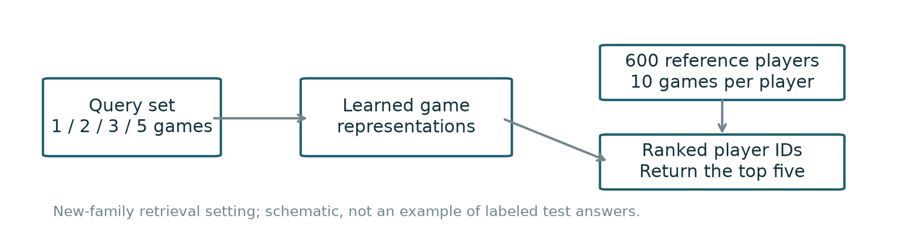
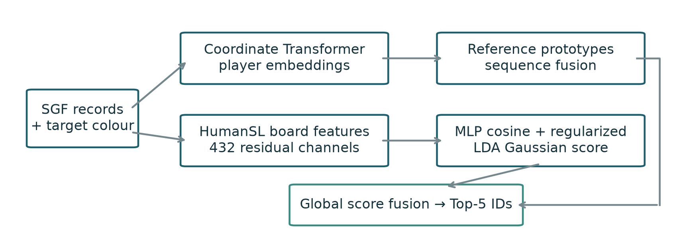
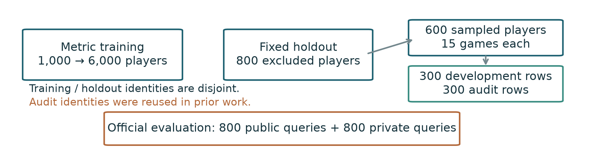
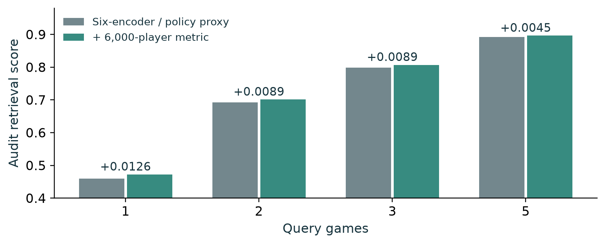

# Identifying Go Players from Game Records

STAT5011 Statistical Deep Learning | James Christian | R13921031

## Abstract

This project studies player identification from Go game records as a retrieval problem. A query contains a small set of games, and the system ranks anonymous candidate players represented by reference games. The approach combines coordinate-sequence Transformers trained with angular-margin identity supervision with features from KataGo HumanSL, a pretrained model of human moves. A learned policy metric and a regularized Gaussian reference model supplement the sequence ensemble. The highest achieved public score is 0.8686865. The team ranked 20 of 125 in the November 22 snapshot. These are interim competition results, not the final private ranking.

## 1 Research motivation and problem

A game record contains decisions rather than an explicit biometric identifier. Move sequences may reflect opening preferences, local responses, risk tolerance, or playing strength. Identifying a player from such behavior is a form of behavioral stylometry. It is useful for studying how representation learning separates stable individual tendencies from properties shared by many players. It also raises privacy questions because an apparently anonymous sequence may reveal a persistent identity [1, 2].

The input consists of SGF records, target-player colour, and a candidate reference collection. For query Q and candidate player c, the objective is to learn a score S(Q,c) and return five distinct IDs in descending order. In the harder test family, Q contains only one, two, three, or five games, while each of 600 candidates has ten reference games. The target identity may occur in multiple queries; a one-to-one assignment constraint is therefore inappropriate.



The research questions are whether move-sequence embeddings generalize across players, whether board-conditioned decision features add information beyond coordinates, and whether reference-game variability should influence matching. The project is evaluated with the official exponentially discounted top-five score, rather than ordinary classification accuracy. An exact top-one identification contributes one; positions two through five contribute progressively less [1].

# 2 Data and evaluation setting

The official processed training collection contains 1,000,000 games from 8,007 player IDs. The aggregate counts were computed directly from the project training arrays. SGF records supply move order and board coordinates; the processing also records target-player colour and handicap. The training distribution is uneven: 1,015 players have fewer than 15 games, whereas 1,274 have at least 240. This matters for identity classification and for choosing players with enough games to construct retrieval episodes.


Test family per public or private pool | Original | New
--- | --- | ---
Candidate players | 400 | 600
Reference games per player | 100 | 10
Query game counts | 5, 10, 15, 20 | 1, 2, 3, 5
Questions per pool | 400 | 400

Each family has separate public and private files. There are 1,600 submitted prediction rows in total: 800 public questions and 800 private questions. Within each family and split, each of the four query sizes occurs 100 times. Candidate players can repeat across questions. The original pools contain 40,000 reference games each; the new pools contain 6,000 each. The November 11 test update reset the leaderboard, so the experiment uses the updated test files rather than combining scores across incompatible versions [1].

For a query whose correct player appears at rank r, the utility is exp(-(r-1)) if r is at most five and zero otherwise. Thus the five nonzero rewards are approximately 1.0000, 0.3679, 0.1353, 0.0498, and 0.0183. The reported public number averages this ranking utility on the public evaluation subset. It should not be described as a percentage of queries classified correctly.

Raw game records and restricted competition files are not redistributed in the course repository. The repository contains aggregate statistics, source code, result evidence, and instructions for placing an authorized copy of the official data. The official v1.1 archive checksum and frozen model references support version control of the inputs.

# 3 Literature review and model comparison

Transformers model interactions between positions through self-attention rather than a fixed local receptive field. Their original formulation established a general sequence-modeling architecture [3]. Here, the relevant sequence is the ordered list of Go moves. Coordinates alone do not explicitly encode captures or tactical board structure, but language-model pretraining can learn regularities in move transitions. This motivates a second, board-conditioned representation rather than assuming that a larger sequence model solves all aspects of the task.

McIlroy-Young et al. studied behavioral stylometry in chess using Transformers and few-shot player identification [2]. Their setting supports the idea that decision sequences contain individual signatures. Their reported accuracy is not directly comparable with this competition: the game, candidate set, number of reference games, and metric differ. This report uses the paper to motivate retrieval representations, not to claim that its numerical results transfer to Go.

ArcFace adds an angular margin to normalized classifier logits [4]. Although proposed for face recognition, the objective can encourage identity embeddings with compact within-player structure. The project applies this loss to game embeddings and discards the training-player classifier at retrieval time. The inference target is similarity to supplied reference games, not prediction of one of the training labels.

KataGo HumanSL predicts human moves conditioned on player profiles [5]. The frozen humanv0 network is therefore a task-related source of board-state features, but it is not an identity-recognition backbone. The model can reflect rank, server, and game-context effects as well as style. Local scaling, such as CSLS in embedding retrieval [6], also motivates attention to crowded neighborhoods; it does not establish that an unmodified language-translation retrieval rule is optimal for Go.

Approach | Representation and role | Limitation
--- | --- | ---
Official tutorial [7] | Board-history ResNet and retrieval baseline | Different baseline protocol
Sequence branch | Move LM → identity embedding | Board state is implicit
HumanSL branch [5] | Frozen contextual decision features | Not trained for player identity
Metric and fusion | MLP, LDA and Gaussian matching | Selection can overfit validation

The resulting contribution is an empirical combination of task-specific sequence learning and pretrained decision features, with negative results and reproduction checks retained. The evidence does not establish a new state-of-the-art architecture. The leading teams’ private methods are unknown, and the observed leaderboard gap cannot identify which backbone they use.

# 4 Deep representations and policy features

The coordinate language model embeds board location, move colour, positional index, and handicap context, then applies Transformer layers. The LM4 configuration uses hidden width 1,024, 16 layers, 16 attention heads, and a maximum of 320 plies. Identity fine-tuning pools hidden states from the target player’s moves and projects them to a normalized 256-dimensional embedding. For the accepted LM4-derived member, the run used seed zero, four epochs, learning rate 0.0001, ArcFace scale 20 and margin 0.1, and no orientation augmentation. Epoch two was selected in advance for this all-player run.

For normalized embedding e and class direction W_y, the target logit is s cos(theta_y + m), while competing logits are s cos(theta_j). Cross-entropy then trains the identity representation. At retrieval time, normalized game embeddings are averaged within each reference or query set and compared by cosine similarity. The production coordinate score also inherits earlier multi-model, auxiliary-view and rank-gating fusion; it is not the output of a single Transformer.



The HumanSL branch reconstructs board states and samples up to 48 own moves between plies 8 and 199. It uses the frozen b18c384nbt-humanv0 model with a fixed 3-dan profile. At each sampled decision, h(a) concatenates the 384-channel contextual trunk feature and the 48-channel policy-head feature at board point a. The residual is the feature at the actual move minus its policy-weighted expectation:

```text
r = h(a_played) - sum_a pi(a | board, profile) h(a)
```

The expectation is conditioned on the 361 non-pass board points. A game is summarized by the mean of these 432 residual channels. The policy-head component has a gradient interpretation for a conditional move model; the trunk component is treated only as a contextual residual feature. Games with unsupported handicap setup or failed replay are rejected as whole games, rather than retaining a corrupted prefix. The audited new-family test extraction processed all 14,200 games successfully.

A small network maps standardized residual means through LayerNorm, a 512-unit GELU layer with dropout 0.15, and a 256-dimensional output. ArcFace training uses 1,000 players outside the fixed holdout. AdamW uses learning rate 0.001 and weight decay 0.05. The preserved checkpoint is epoch five; longer training worsened local retrieval. Reference and query game embeddings are pooled before cosine scoring.

# 5 Regularized matching and experimental protocol

A player’s ten reference games need not form a single tightly concentrated point. To represent within-player variation, the policy residual is standardized using training statistics and projected using regularized linear discriminant analysis. The selected model uses 128 dimensions and a within-class covariance shrunk halfway toward a scaled identity matrix. This fixed shrinkage is a modeling choice, not an estimated optimal shrinkage coefficient.

In the projected space, each player has a reference mean mu_c and a diagonal game variance v_c. The scoring variance is 0.8 times the pooled reference variance plus 0.2 times the player-specific variance, with a small numerical floor. For a query mean qbar based on k games, the Gaussian score uses a quadratic distance scaled by 1/k + 1/10 and a log-variance penalty. This approximates uncertainty in two finite game-set means; dependence between games can invalidate a literal probabilistic interpretation.

```text
G(q,c) = -0.5 sum_j [(qbar_j - mu_cj)^2 / {v_cj (1/k + 1/10)} + log(v_cj)]
```

Scores are standardized within each query over candidate players. The accepted combination is:

```text
S = z(S_coordinate with LM4) + 0.25 z(S_policy MLP) + 0.10 z(G)
```



A fixed seed excludes 800 player IDs from metric training. The policy pilot samples 600 of those players with 15 games each. Five fixed permutations create ten reference games and five disjoint potential query games; query sizes one, two, three and five are evaluated. Hyperparameters are selected on 300 query-player rows, while the other 300 rows form a separate audit within the same 600-candidate retrieval pool. Reference and query game indices are disjoint in each episode.

The audit identities had already appeared in earlier experiments, and the six-encoder local baseline is a proxy for the larger production ensemble. Consequently, the audit is useful for controlled local comparisons but is not an untouched estimate of generalization. Public feedback also influenced global fusion weights across many submissions. A final private evaluation is necessary to assess the effect of this adaptive selection.

# 6 Competition experiments and results

The highest achieved public score through the recorded November 22 snapshot is 0.8686865. TEAM_10990 was ranked 20 of 125 teams. The leader scored 0.9313515, leaving a gap of 0.0626650. These are interim results; the final ranking is determined by the competition’s private evaluation. The best artifact is g22_cx40.csv, whose exact SHA-256 is preserved in the evidence manifest.


Configuration | Public score | Change from prior best
--- | --- | ---
Raw reconstruction + policy scores | 0.8670060 | -0.0004599
Learned-policy weight 0.10 | 0.8633956 | -0.0040703
Gaussian weight 0.05 | 0.8671240 | -0.0003419
LM4 + policy 0.25 + Gaussian 0.10 | 0.8686865 | +0.0012206
LM6 + policy 0.25 + Gaussian 0.10 | 0.8682102 | +0.0007443

The lower learned-policy weight regressed substantially, whereas the selected small Gaussian contribution remained useful. Adding the independently trained LM4 encoder improved the accepted combination. The LM6 alternative also improved on the prior best but did not exceed the LM4 combination. These results support complementarity at these specific settings; they do not isolate every inherited component of the ensemble.

Negative results are important. On November 21, the unmodified regularized cosine metric scored 0.8649376, trunk-only matching 0.8652248, and the combined residual-statistics representation 0.8583048. Variance-aware matching at weight 0.25 nearly tied the then-best score, while reducing its weight to 0.10 produced 0.8674659. A related learned-policy checkpoint improved local retrieval despite the raw unlearned policy feature reducing the public score. A local gain therefore did not reliably predict the direction or size of a leaderboard gain.

# 7 Scaling study and conclusions

The first policy metric used 15,000 games from 1,000 training players. The scaling study adds 5,000 distinct players and 75,000 games, for a total of 90,000 games and 6,000 training identities. Both extraction shards finished without replay errors, and the added IDs were excluded from the fixed 800-player holdout. The saved metric, training-feature shards, inference output and validation record were backed up automatically.



Query games | Local proxy | With expanded metric | Gain
--- | --- | --- | ---
1 | 0.4597 | 0.4722 | +0.0126
2 | 0.6922 | 0.7011 | +0.0089
3 | 0.7980 | 0.8070 | +0.0089
5 | 0.8917 | 0.8962 | +0.0045
Mean | 0.7104 | 0.7191 | +0.0087

The selected expanded LDA uses shrinkage 0.5, 128 dimensions and an added weight of 0.25. The improvement is positive at all four query sizes and is largest for one-game queries. Its public evaluation was pending at the reporting cutoff. The selected setting was chosen using development rows; the displayed audit is separate within this experiment, but earlier identity reuse still limits its interpretation.

Several limitations remain. Games from the same player can be correlated, so treating repeated seeds as independent replications would give optimistic uncertainty estimates. No calibrated confidence interval or significance claim is made here. The HumanSL profile is fixed despite varying strength and context. The production ensemble and local proxy differ. Repeated public-score selection risks overfitting the public subset, and the final private result is not yet available.

Saved-model inference from frozen parent scores and extracted policy features reproduces the accepted CSV byte for byte. A legacy base-view component still differs in lower ranks when rebuilt from raw data; the separate raw reconstruction scored 0.8670060. Thus exact cached/saved-model reproduction is established, while full raw-input equality remains unresolved. The project demonstrates an effective combination of sequence identity learning, board-conditioned residuals and conservative statistical fusion, but it has not closed the gap to the leading team.

# References

[1] AIdea and National Dong Hwa University. AI CUP 2026 Go Playing-Strength and Style Prediction Competition, Task 1. Official topic and November 11 updated-data notice. https://www.aidea-web.tw/topic/dc0b799e-690f-4e84-a597-93e68d8ba688. Accessed November 22, 2026.

[2] McIlroy-Young, R., Wang, R., Sen, S., Kleinberg, J., and Anderson, A. Detecting Individual Decision-Making Style: Exploring Behavioral Stylometry in Chess. Advances in Neural Information Processing Systems 34, 2021. Author version: https://arxiv.org/abs/2208.01366.

[3] Vaswani, A., et al. Attention Is All You Need. Advances in Neural Information Processing Systems 30, 2017. https://arxiv.org/abs/1706.03762.

[4] Deng, J., Guo, J., Xue, N., and Zafeiriou, S. ArcFace: Additive Angular Margin Loss for Deep Face Recognition. CVPR, 2019. https://arxiv.org/abs/1801.07698. The arXiv record was revised after the original conference version.

[5] Wu, D. J., and KataGo contributors. KataGo Human SL Analysis Guide and humanv0 release. Model introduced with KataGo v1.15.0, 2024. https://github.com/lightvector/KataGo/blob/master/docs/Analysis_Engine.md#human-sl-analysis-guide. Frozen source commit d91ea855110dae533f0aada947b2b7d78cc8a4e1. Network license: https://katagotraining.org/network_license/.

[6] Conneau, A., Lample, G., Ranzato, M., Denoyer, L., and Jegou, H. Word Translation Without Parallel Data. ICLR, 2018. https://arxiv.org/abs/1710.04087. Cited for the CSLS retrieval motivation, not for a Go accuracy claim.

[7] AILAB-NDHU. AICup-2026-Tutorial. Official tutorial code. https://github.com/AILAB-NDHU/AICup-2026-Tutorial. Accessed November 22, 2026.

[8] Christian, J. STAT5011 Go Player Identification project evidence. Frozen competition release go-best-20261122, source commit 32a0e9f; sanitized score receipts, dataset summary, and validation JSONs are included in this course repository. These artifacts support the project-specific numerical claims.


# Member contribution statement

James Christian (R13921031) is the only supplied course member. Project direction and review are attributed to James Christian; coding, research and drafting were AI assisted. See the separate final page of the DOCX/PDF for the full statement.


# Appendix A Experiment evidence

```csv
day_jst,candidate,public_score,sha256,backup_release
2026-11-20,go20_cx40mlp.csv,0.8637488,7ec595dc65e6a27608e6f456984fc14d8e755741f2243adeb37894efce2eb38f,go-policy-sweep-20261120
2026-11-20,go20_cx43mlp.csv,0.8638328,4942f653afeddd2ad1ad93cb48b6ce16e9ccabaa614518c3f7db8390ff2bf964,go-policy-sweep-20261120
2026-11-20,go20_hslfp.csv,0.8601658,93887a465e18c20f008365e034300d3c0ac5e96ef5d312b5a1928d3a9c5039c8,go-policy-candidate-20261119
2026-11-20,go20_hslmlp.csv,0.8639543,539826ab8b184c606e4ac198b9097281b9ada0efe4e1a6001b7f2e1ffad6fa5b,go-policy-metric-20261120
2026-11-20,go20_mlp025.csv,0.8666413,311d5c470e2c0b28fdda4c5c25916f4f3e28d30dda5c8080a59e15b2d781a410,go-policy-sweep-20261120
2026-11-21,go21_lda.csv,0.8649376,2b22215bcbbfe4ee562453bc7befd7ffb005e94e0e768713895c5baabe0e6857,go-policy-lda-20261120
2026-11-21,go21_setmatch.csv,0.8665537,c00a134af784f4ca1678ebd7ff4f5d66e837a1e4c0be8305b4a0618c8407f9d2,go-policy-setmatch-20261121
2026-11-21,go21_trunk.csv,0.8652248,74698d4cfbcec8e16f26a5371b6c82efa6294bdf55abe30e1834d2351c9f6392,go-policy-block-20261121
2026-11-21,go21_stats_combined.csv,0.8583048,3daf23e75419fc40a4856e1b196af3b7c8868def32f3250275f74e42b3ffd70f,go-policy-stats-20261121
2026-11-21,go21_damped.csv,0.8674659,14f521f345ac741284028ec424cc37c16f29a0e087f8d798eb89edaeaf34452a,go-policy-damping-20261121
2026-11-22,g22_raw.csv,0.867006,cb6d2080dce3dd91fa13fad9743e0c4d0f395fa0e7b4263ce5c04ffcd662cb82,go-daily-candidates-20261122
2026-11-22,g22_m010.csv,0.8633956,69564b61b8000866ee3c6d1471ab3ad55955fe575012e91ba14bc53064dcf1c7,go-daily-candidates-20261122
2026-11-22,g22_g005.csv,0.867124,11f8e3225bf1e2df6bb125745ec0b18bfb8d71be29056482f9113d1dff22a60b,go-daily-candidates-20261122
2026-11-22,g22_cx40.csv,0.8686865,123a07fc353790bc983a76862d10db96e03399df4160a3e7af44deb293b61fdb,go-daily-candidates-20261122
2026-11-22,g22_cx43.csv,0.8682102,95edbe1d0ae901f06e1dea1a781b244cb408e24d74a3581fe33c55eb37711088,go-daily-candidates-20261122
```
